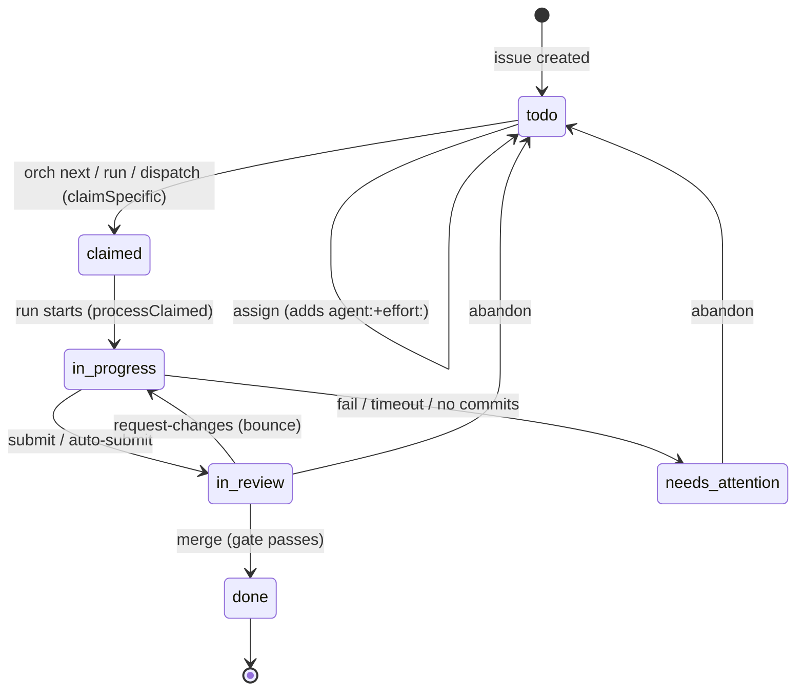

# WORKFLOW — labels & issue lifecycle

The single reference for **every label orch relies on** and **exactly when each is set
or cleared**. Traced from source (`src/github/labels.ts`, `src/tasks/service.ts`,
`src/tasks/runner.ts`, `src/board/review.ts`, `src/board/board.ts`,
`src/commands/abandon.ts`, `src/tasks/reconcile.ts`) — if code and this table disagree, the
code wins and this file is the bug. Vocabulary lives in `CONTEXT.md`.

The built-in labels are created by `orch init` from the canonical set in `src/github/labels.ts`.

**Schema drift & self-heal.** The canonical set is **additive** — new labels arrive with
new features (e.g. `effort:*` in #20, `assigned-by:brain` with the judge), so a repo
initialised earlier can lag behind. `gh issue edit --add-label` fails hard on a label the
repo lacks, so two safety nets close the gap: (1) `orch doctor` reports any missing canonical
labels with a `run orch init` hint, and (2) the routing writers — `orch assign` and the
dashboard `POST /actions/assign` — call `ensureLabels(labelDefs(...))` before adding
`agent:`/`effort:`/`assigned-by:brain`, so applying routing to a stale repo self-heals rather
than failing. Re-running `orch init` still backfills the whole set at once.

## Label catalogue

| Label | Color | Meaning | Set by | Cleared by |
|---|---|---|---|---|
| `status:todo` | `ededed` | Ready to be claimed (the implicit default when no `status:*` present) | `orch init`; `abandon` (reset); `repair` projection | `claimSpecific`; `repair` projection |
| `status:claimed` | `fbca04` | Lock held, worktree being set up | `claimSpecific`; `repair` projection | `processClaimed` start/recovery; `submit`; `abandon`; `repair` projection |
| `status:in-progress` | `0e8a16` | Harness is running | `processClaimed` start; `requestChanges` (bounce back); `repair` projection | `submit`; runner recovery; `abandon`; `repair` projection |
| `status:in-review` | `1d76db` | PR open, awaiting cross-review | `submit`; `repair` projection | `requestChanges`; `merge`; `abandon`; `repair` projection |
| `status:done` | `5319e7` | Merged | `merge`; `repair` projection | `repair` projection only if observed facts no longer derive `done` |
| `status:blocked` | `b60205` | **⚠ Defined but never applied** — see note below | *(nothing)* | `repair` (stale lifecycle projection) |
| `agent:claude` / `agent:codex` | purple/blue | Owner — which harness runs it | `assign`; `plan` (ticket `agent`); `claimSpecific` | `abandon` only (**sticky**) |
| `role:<name>` | user-defined | Constrain routing to `roles[name].tiers` and `.families` | Human / external issue author (create the label manually) | Human / external issue author |
| `review:needed` | `e99695` | Awaiting review by the *other* harness | `submit`; `repair` for an open task PR without current approval or current-head changes requested | `approve`; `requestChanges`; `repair` after current approval, current-head changes requested, or PR closure |
| `reviewed-by:claude` / `reviewed-by:codex` | `c5def5` | Projection of a commit-bound review decision | `approve`; `repair` from current review records | `requestChanges`; `repair` removes stale or revoked approvals |
| `needs-attention` | `d93f0b` | Run failed, produced nothing, or has facts repair will not guess through | `processClaimed` recovery (fail, timeout, exception, no-commits); `repair` projection | `abandon`; `repair` after facts become coherent |

`needs-attention` blocks automatic selection, direct claims, and targeted dispatch,
including issues with `status:todo` or no `status:` label. Failed-run recovery removes
`status:claimed` and `status:in-progress` while setting this hold. Clear the hold
explicitly after recovery before retrying implementation.
| `effort:free` | `c2e0c6` | Use the agent's *free* model tier | `assign`; `plan`; autopilot triage | triage may raise one tier, capped at lead |
| `effort:cheap` | `c2e0c6` | Use the agent's *cheap* model tier | `assign`; `plan`; autopilot triage | triage may raise one tier, capped at lead |
| `effort:standard` | `c2e0c6` | Use the agent's *standard* model tier | `assign`; `plan`; autopilot triage | triage may raise one tier, capped at lead |
| `effort:lead` | `f9d0c4` | Use the agent's *lead* model tier | `assign`; `plan`; autopilot triage | never raised further |
| `assigned-by:brain` | `bfd4f2` | Provenance: this routing came from the judge, not a human | `assign --auto` / `POST /actions/assign` (origin brain) | *(future re-route pass)* |

Legacy `effort:easy` / `effort:hard` labels and config model keys resolve as `standard` / `lead`. The optional `tierAliases: { "easy": "cheap", "hard": "lead" }` config overrides legacy mappings; canonical names always resolve directly and explicit canonical model keys win over aliases. All four tiers keep Sonnet 5.5 medium / gpt-6.1-sol medium by default.

**Sticky** = set at routing/claim time and honored on future runs. `abandon` clears
`agent:`; triage can raise `effort:`. With an explicit `tierMembers` ladder, a failed
implementation refused for quota or endpoint availability can replace `agent:` and
`effort:` with the next allowed member and set `model:<id>` to select its configured
model, reasoning effort, and family. Routing labels are ensured before writing.
The runner first proves no commits ahead and no open PR, safely removes the worktree,
and releases the lock; only then does it relabel `status:todo` without `needs-attention`.
If the ladder is exhausted or absent, existing requeue/wait behavior applies.
`model:` is cleared by abandon and tier-raising triage; independent review uses the
  reviewer's own premium model, while author identity uses the projected member.
  A `model:` label whose member has been removed from configuration makes that task
  inconsistent and blocks claiming; other tasks remain observable and claimable.
  `orch repair <issue>` previews removal of the stale label; `--apply` removes it
  and re-observes before further repairs, restoring normal configured tier selection.
Autopilot also cascades a review fix or conflict-resolution step after one failed attempt
on the current PR head when a next member exists. It replaces routing labels while
retaining the PR, claim and worktree, then re-observes before retrying with a fresh
session. With no next member the existing retry, triage and escalation policy applies.
A failed CI fix instead escalates directly to a human, without changing tier or model
labels or requesting lead triage. A fix must change files relative to the observed PR
head: empty commits and commits with no net file changes fail before pushing and do
not count as progress.
Each successful hop writes `cascade.hop`; implementation runs also carry
`cascadeFrom`/`cascadeTo` in their run record.
Cascade selection skips members whose resolved endpoint (or harness for Claude/Codex)
is on cooldown. A failed OpenCode pre-claim health ping cools the endpoint for ten
minutes and immediately advances the todo's routing labels to the next available
member. This writes `cascade.hop` after successful relabelling, with no implementation
run record because no harness was invoked. Without a next member the todo waits.

A task without a `role:` label remains unrestricted. A named role must exist in
`orch.config.json`; unknown roles, disallowed tiers, and disallowed provider families
are rejected during assignment and before harness execution. Orch does not add or
remove role labels. The selected model's `family` overrides the adapter's family;
Claude defaults to `anthropic`, Codex to `openai`. OpenCode must specify `family`
on each configured model (including `leadModel`). These are routing constraints;
review approval policy is configured separately.

## Lifecycle (happy path)

## Transition ledger (who writes what)

Each row is one atomic `editIssue`. `+` = add label, `−` = remove label.

| Event | Fn | `+` | `−` | Side effects |
|---|---|---|---|---|
| Create from a plan | `plan <tickets>` / `/actions/plan-create` | `status:todo`, plus `agent:X`/`effort:Y` when the ticket routes it | — | only on *newly created* issues (a reused issue is never relabelled); an unconfigured agent or unknown effort is dropped, and an effort without an agent is dropped so the judge routes the issue whole; routing labels are ensured first. No `assigned-by:brain`: the routing was approved with the plan |
| Route (human) | `assign --apply` | `agent:X`, `effort:Y` | — | fill-blanks-only; skips already-pinned |
| Route (judge) | `assign --auto` / `/actions/assign` | `agent:X`, `effort:Y`, `assigned-by:brain` | — | judge-authored; same fill-blanks-only writer |
| Claim | `claimSpecific` | `status:claimed`, `agent:X` | `status:todo` | owner-token lock, assign `@me`, cut worktree; compensate on incomplete setup |
| Run start | `processClaimed` via `run` / `dispatch` / `/actions/dispatch` | `status:in-progress` | `status:claimed` | spawn harness at resolved model |
| Submit | `submit` | `status:in-review`, `review:needed` | `status:claimed`, `status:in-progress` | push branch, open PR (`Closes #n`) |
| Run fails / times out | `processClaimed` | `needs-attention` | `status:claimed`, `status:in-progress` | safely prune only if clean, attached, and preserved; release lock only when removed |
| Run exception / submit uncertainty | `processClaimed` | `needs-attention` | `status:claimed`, `status:in-progress` | preserve worktree and lock after a successful harness result; otherwise use the same conditional safe cleanup |
| Run dies on a usage limit | `processClaimed` | `status:todo` | `status:claimed`, `status:in-progress` | only if safe cleanup removes the worktree (nothing left behind): remove it, release the lock, *then* relabel; telemetry `usage-limited` (not a failed run). Otherwise falls through to the "Run fails" row |
| Completed run, uncommitted changes and no commits | `processClaimed` | `status:in-review`, `review:needed` | `status:claimed`, `status:in-progress` | coordinator runs configured `verify`, stages and commits output, then uses normal submit |
| Coordinator verification fails | `processClaimed` | `needs-attention` | `status:claimed`, `status:in-progress` | retain worktree and lock; comment failing argv and output tail; no commit or submit |
| Worker diff violates pack role scope | leftover commit / `submit` / autopilot / automated review | `needs-attention` | leftover commit and submit remove `status:claimed`, `status:in-progress` | retain worktree and lock; comment each offending path and reason; no commit, submission or review at the refusing boundary |
| Run, clean and no commits | `processClaimed` | `needs-attention` | `status:claimed`, `status:in-progress` | safely prune only if clean, attached, and preserved; release lock only when removed |
| Approve | `approve` | `reviewed-by:X` | `review:needed` | structured COMMENT review bound to the reviewed head |
| Review (automated) | `runAutomatedReview` (`orch review-run`) | via `approve` / `requestChanges` | via `approve` / `requestChanges` | read-only headless session by the other harness (or a fresh self-review fallback), strict JSON verdict, recorded only if the PR head is unchanged |
| Request changes | `requestChanges` | `status:in-progress` | `review:needed`, `status:in-review` | structured revocation; clears `reviewed-by:*` |
| Merge | `merge` | `status:done` | `status:in-review` | gate check, squash-merge, safely prune worktree, release lock |
| Repair preview | `repair [issue]` | — | — | re-observe issue/PR, lock, branch, worktree, and telemetry; print safe idempotent actions only |
| Repair apply | `repair [issue] --apply` | derived lifecycle label; current `reviewed-by:*`; sometimes `review:needed` | stale lifecycle labels; stale `review:needed` and `reviewed-by:*` | run one action, re-observe, and re-plan; may restore locks/branches/worktrees, safely prune terminal worktrees, release stale locks, close a merged PR's issue, or supersede resolved failure telemetry |
| Abandon (safe) | `abandon` | `status:todo` | `status:claimed`, `status:in-progress`, `status:in-review`, `needs-attention`, `agent:X` | safely remove only clean, attached, externally preserved work; otherwise stop with lock/labels intact |
| Abandon (destructive) | `abandon --discard` | `status:todo` | `status:claimed`, `status:in-progress`, `status:in-review`, `needs-attention`, `agent:X` | explicit human intent: force-remove retained worktree, then release lock |

## Repair and destructive intent

`orch repair [issue]` is preview-only unless `--apply` is present. The reconciler
collects fresh external facts, derives state through `deriveTaskState`, and plans from
those facts rather than trusting labels. Apply executes exactly one idempotent action,
then re-observes and re-plans. A lost response or interruption therefore has no hidden
resume cursor: rerunning repair continues from whatever durable side effects are visible,
and a second successful run converges to no actions.

For a closed issue with a merged PR, repair preserves `status:done` and existing
`reviewed-by:*` labels even when local resources remain. It reports retained worktrees
as cleanup residue, without adding `needs-attention` to the finished issue. Safe
cleanup and lock release still require the usual preservation proofs.

Repair may prune a registration whose directory is already absent, but it never force
removes a worktree or deletes a branch. Dirty, untracked, ignored, detached, conflicted,
or not-otherwise-preserved work is reported and kept under its lock. Destruction is a
separate human decision: `orch abandon <issue> --discard`. Plain `abandon` now uses the
same safe-removal proof and refuses to release the lock when retained work exists.
Ignored disposable output is allowed by `disposableIgnored`: trailing `/` entries cover
directories and their contents; simple `*` and `?` filename globs match root files only.
Defaults include `node_modules/`, `dist/`, `coverage/`, `logs/`, and `*.log`. Tracked
modifications and untracked files always block safe cleanup, including matching logs.

## Known wrinkles (documented, not yet fixed)

Claim setup is a recoverable saga rather than a transaction. Before writing, it observes
the issue, exact lock owner, and deterministic worktree path and checks the lifecycle
transition. A unique Git-object id identifies the attempt's lock. After an ambiguous
adapter failure, setup rolls forward only when re-observation proves that attempt owns
the lock or finds the complete expected GitHub/worktree state. Otherwise it restores
the pre-claim routing/assignment fields, removes `status:claimed`, and compare-deletes
only its own lock. Conflicting or unobservable worktrees are never deleted as rollback.

1. **`status:blocked` is vestigial.** It exists in the label set and has a color, but
   **no code path ever applies it** (repair removes it when found as a stale lifecycle
   projection). "Blocked" is computed on read from
   `Depends-on:` lines (`isEligible` → `openDepsFromMap`): a blocked issue simply stays
   `status:todo` and is filtered out of `eligibleIssues`. The snapshot/dashboard may
   *display* blocked-ness, but the label is not the source of that truth. Either wire it
   up or drop it — tracked as a hardening candidate.

2. **`effort:` persists across abandon.** Triage and implementation cascade can replace
   it with a higher tier; other routing changes require a manual label edit.

## Where routing labels get honored

- `effort:` → `resolveTaskModel(agent, issue, cfg)` (a `ModelSpec`) at spawn → `RunContext.model` →
  adapter appends its model/effort flags. No label ⇒ `cfg.defaultEffort` (`lead`).
- `agent:` → `claimNext` skips issues pinned to a different agent.
- Structured PR review metadata for the current head feeds the merge gate; `review:needed` and `reviewed-by:*` are projections only. `review-approve` requires `--head <full-sha>` from `orch review`. Repair preserves `status:in-progress` and clears `review:needed` while the latest structured decision requests changes on the current head. A new head returns the task to review; stale approval labels are removed. The review queue includes explicit `review:needed` PRs without reading reviews, and otherwise recovers stale approvals or orphaned approval labels while excluding current-head changes requested.

## Autopilot (the autonomous loop)

`orch autopilot` (`src/tasks/coordinator.ts`) only *starts* issues that carry an `agent:` label (`--no-claim`: none), and drives
every open task PR. `--issues <list>` (what the `orch plan` pipeline starts) narrows both to the listed issues. It derives each open task PR's next step from facts
(`decideStep`, `src/tasks/steps.ts`) and performs it; it adds no labels of its own beyond the ones below.

| Step | Trigger (facts) | Effect | Labels it sets / clears |
|---|---|---|---|
| review | head has no acceptable approval and no change request | `runAutomatedReview` (read-only, cross or fallback self) | via `approve` / `requestChanges` |
| fix | change request on the head, or red CI | resume the author's session (fresh session if refused); commit; orch pushes (no force) | sets `status:in-review`, `review:needed`; clears `status:in-progress` |
| resolve-conflict | PR conflicts with the base | Claude (else the author) merges `origin/<base>` into the branch; orch checks the base is an ancestor, then pushes | same as fix |
| merge | approved on the head, CI green/none, mergeable | `merge()` through `checkMergeGate` | `status:done`; releases lock, prunes worktree |
| await-human | as merge, with `requireHumanMerge` | nothing; reported | - |
| triage | round budget (`maxReviewRounds` + rounds granted by triage) spent and fewer than `maxLeadTriage` triages recorded on the PR | the lead (on `leadModel`) reads a read-only checkout of the head and decides: `retry` (one more fix round with its guidance) or `escalate`; recorded as an `orch-triage:v1` PR comment | on a retry that asks for it: raises one tier (free -> cheap -> standard -> lead, capped at lead), replacing existing effort labels (the only path that changes `effort:`); escalation as below |
| escalate | round budget spent after triage (or `maxLeadTriage: 0`), the lead's decision, a failed/paused triage, or a step failed twice in a row | comment on the PR | sets `needs-attention` (the loop then ignores the task until a human clears it) |

Run state lives outside GitHub: `~/.orch/<project>/events.jsonl` (every step start/finish and its signal),
`sessions/issue-<n>.json` (the author's conversation id), and `availability.json`. None of it is lifecycle
truth: losing it can only cost a cold start or a blurred statistic. Fix and conflict runs write
`logs/issue-<n>-fix<k>.jsonl` / `-resolve<k>.jsonl` and `runs.jsonl` records with `phase` and `round`.

## Usage-limit availability and self-review

A failed harness run whose log shows a usage-limit refusal puts that agent on cooldown
(`src/board/availability.ts`, `~/.orch/<project>/availability.json`, clamped to 1 minute..12 hours;
default 1 hour when no reset time is given). `processNext` / `dispatchSpecific` will not claim work for
an agent on cooldown. This is runtime state, not an issue label, and never affects lifecycle derivation.
Review records carry reviewer `tier`/`family`; only `standard`/`lead` approvals from a different
model family count. Legacy records retain premium/harness-default identity.
The default `reviewPolicy` is `cross`. Records may carry `mode: "self"`; the gate accepts the author's own approval only when
`reviewPolicy` is `cross-or-self` **and** that record is marked self. Writing a self record is itself
guarded (`assertSelfReviewAllowed`: every eligible different-family reviewer must be unavailable),
and self approvals must also be premium. See [ADR-0011](adr/0011-premium-family-review-and-conflict-resolvers.md).

## Observed health in operator views

Board, status, snapshot, doctor, and dashboard now show the same derived lifecycle health. ready is represented as status:todo for existing routing clients; inconsistent remains distinct from needs-attention in the view even though both project to the needs-attention issue label. Every attention state offers orch repair <issue>, which is preview-only. Closed-issue residue and missing-issue claim resources remain visible until reconciled. Completed issues with no retained claim or worktree are omitted from the board. Doctor lists only lifecycle tasks needing attention. These read paths do not repair or mutate labels.
